# DojoLog - Judo Club Management Platform

**DojoLog** is a full-stack web application developed as [bachelor's thesis](https://dspace.cvut.cz/bitstream/handle/10467/122778/F3-BP-2025-Le-Duc%20Thang-bakalarska-prace-duc-thang-le.pdf?sequence=-1&isAllowed=y) at **FEE CTU, Prague**. The goal was to design and implement a system which digitizes the everyday administration of club **Judo SG Plzeň**. DojoLog simplifies work for both coaches and parents by handling member registration, training planning, and event management.

Application is already in **production** and actively used by the club.

### [🌐 Explore DojoLog](https://dojolog.cz/)

## 🛠️ Tech Stack

- **Frontend**: React.js
- **Backend**: Java, Spring Boot
- **Database**: PostgreSQL
- **Authentication**: JSON Web Token (JWT)

## 🔑 Key Features

### **Parent**
- Register and manage child profiles.
- Enroll children into trainings and events.
- Track children's attendance.

### **Trainer**
- Record children's attendance for trainings and events.
- Record the training program.
- View monthly earnings.

### **Admin**
- Manage schools, trainings, and events.
- Approve child registrations and assign trainers.
- Publish news for all users.

## 🖥️ App Preview

### Landing Page

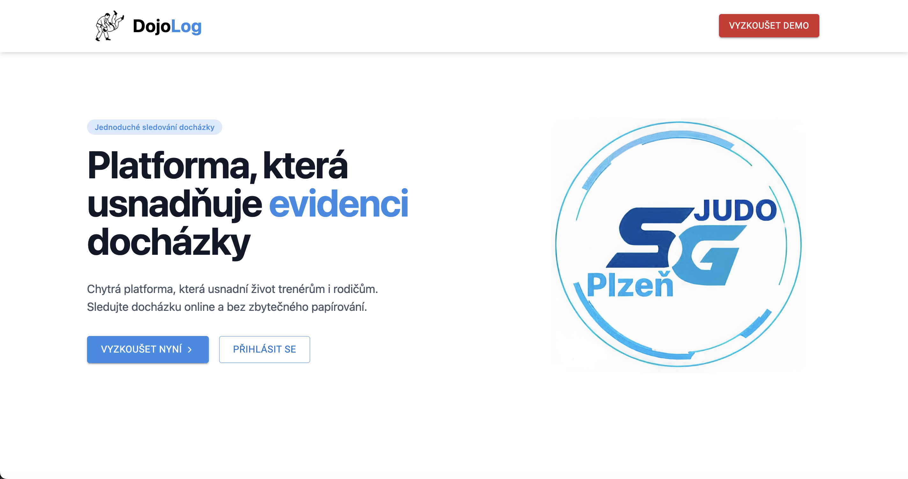

### Parent - Registration, Dashboard, and Events

| Child registration | Child training overview |
| --- | --- |
| 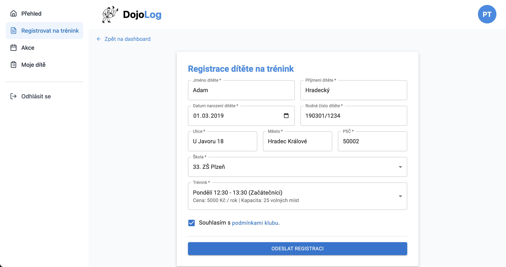 | 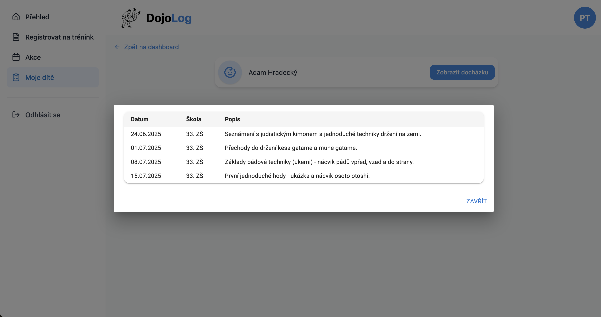 |

| Parent dashboard before registration | Parent dashboard |
| --- | --- |
| 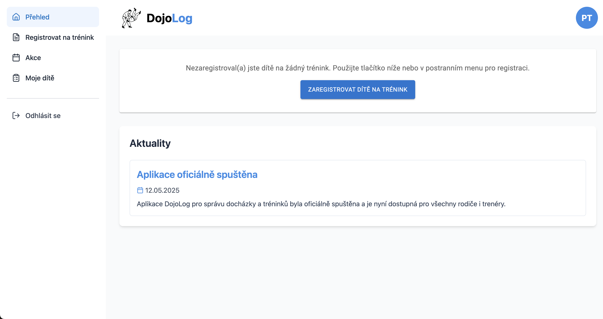 | 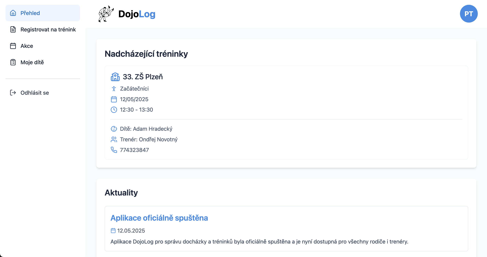 |

| Event details | Event registration |
| --- | --- |
| 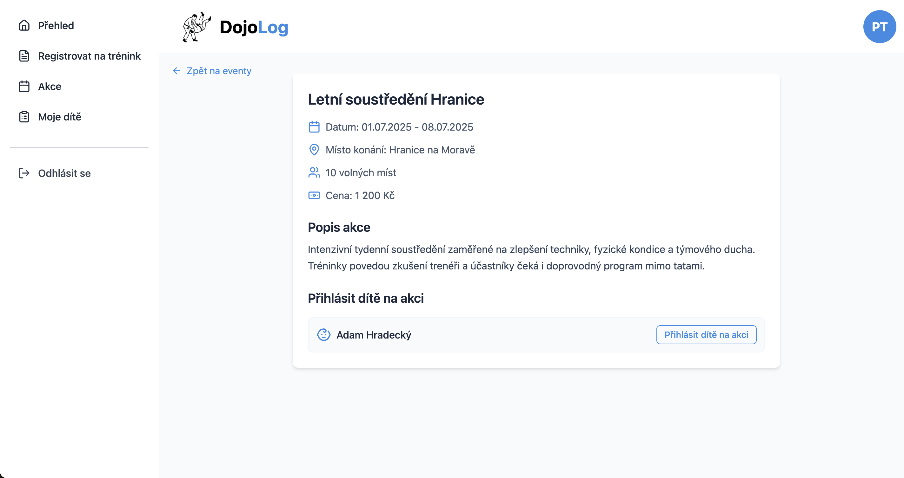 | 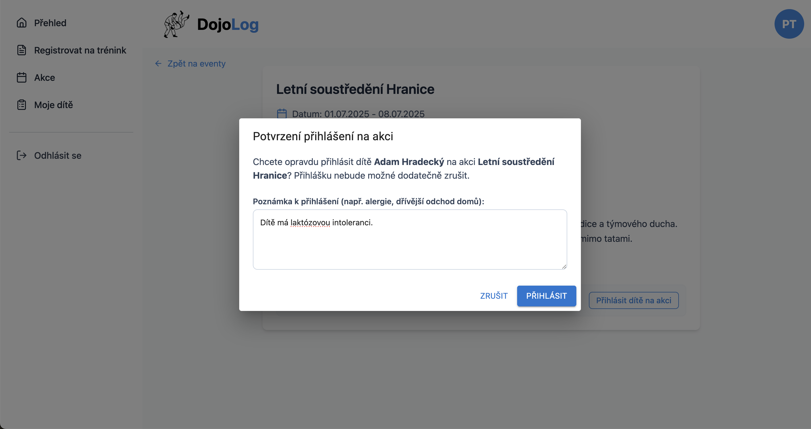 |

### Trainer - Attendance, Events, and Reports

| Trainer dashboard | Attendance table |
| --- | --- |
| 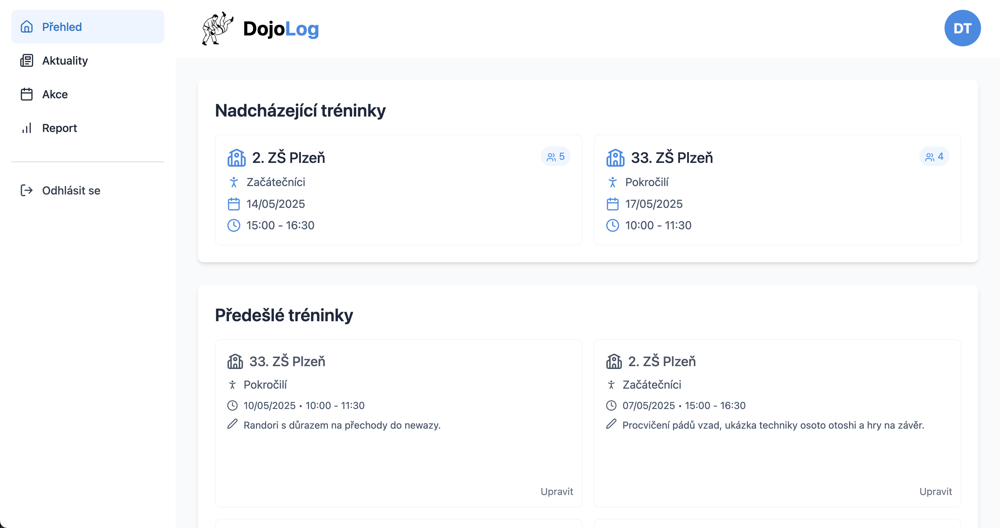 | 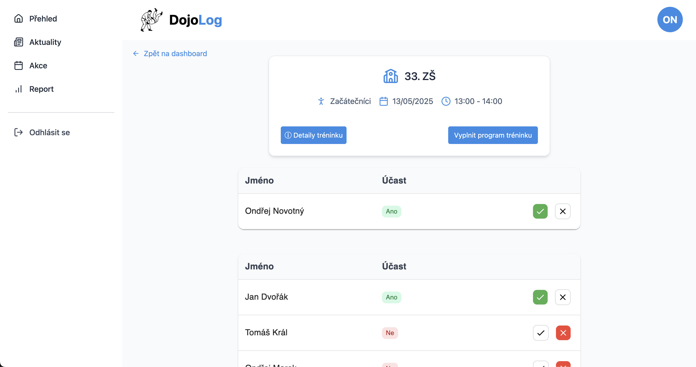 |

| Training instructions | Parent contact details |
| --- | --- |
| 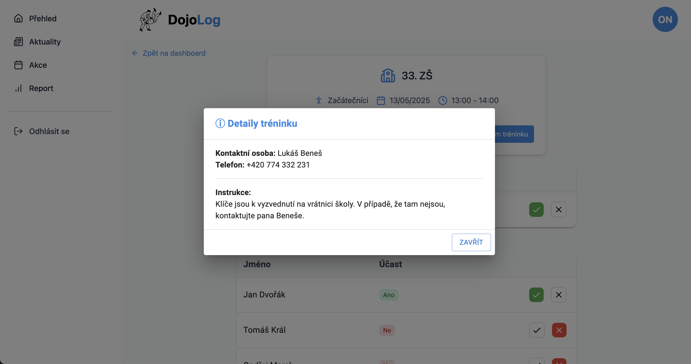 | 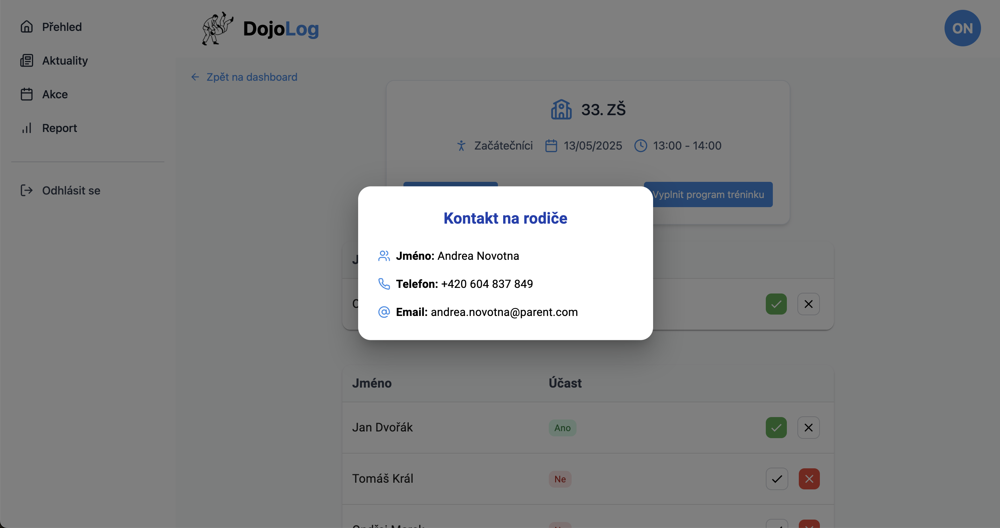 |

| Event details | Trainer report |
| --- | --- |
| 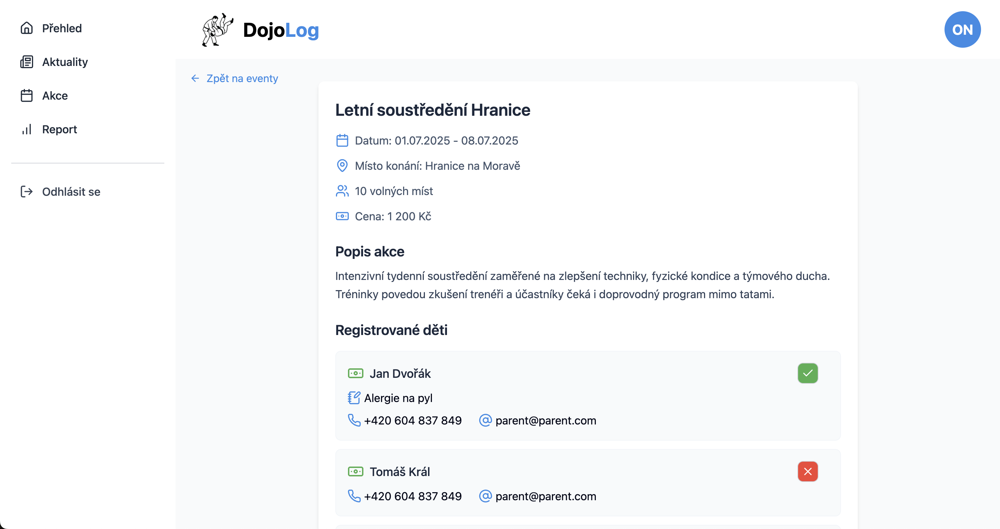 | 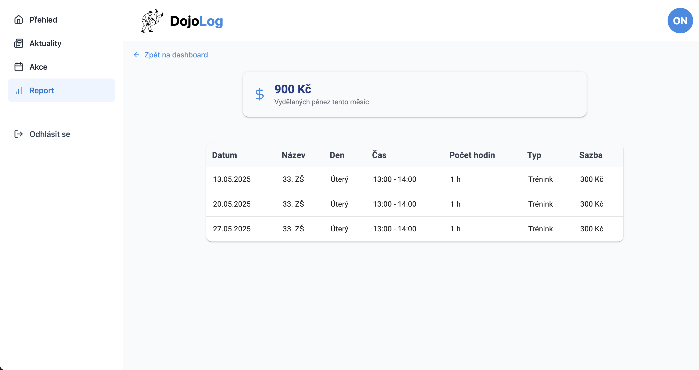 |

### Admin

| Admin dashboard | Registration approvals |
| --- | --- |
| 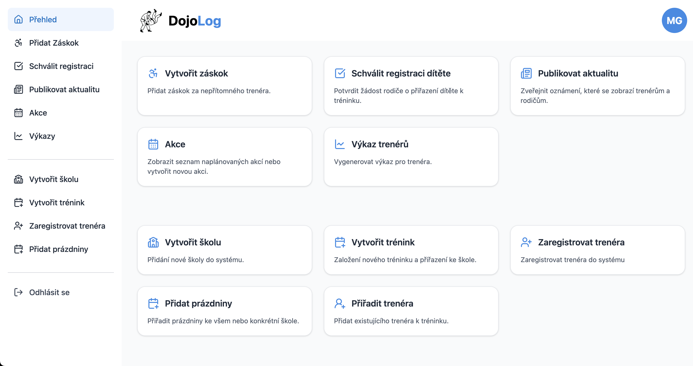 | 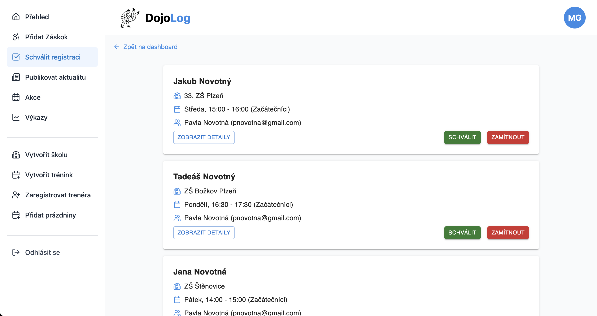 |

| Holiday management |
| --- |
| 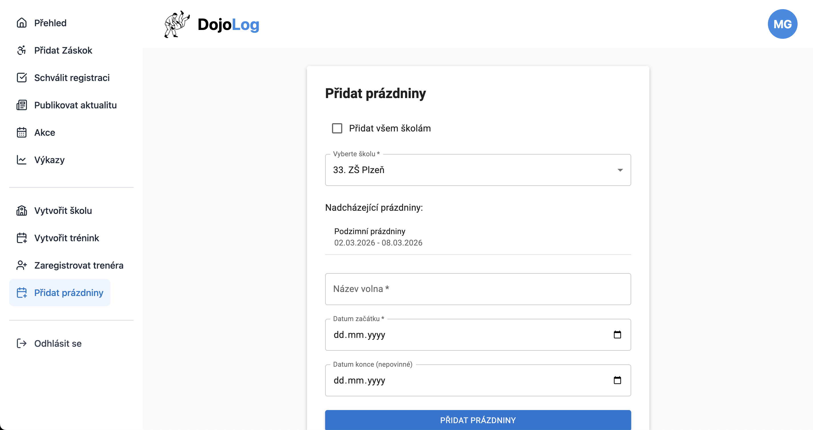 |
